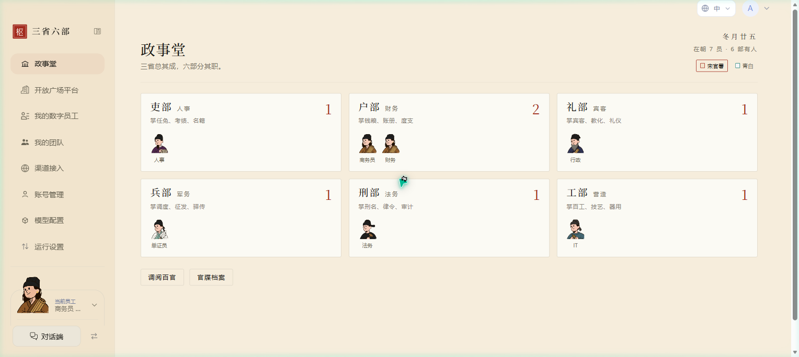

<div align="center">

# 三省六部

**数字员工政事堂**

把一堆平铺的 AI 助手，组织成一座有分工、有位次的官署

[](LICENSE)
[](#)
[](#)

</div>



---

## 这是什么

三省六部是一个数字员工工作台。它要解决的问题不是「AI 能不能干活」，而是——**当 AI 员工多到十几个之后，你怎么知道谁在负责什么、该不该批准它、它到底干得怎么样。**

答案借鉴了一千三百年前的组织智慧：不把员工平铺成一张卡片列表，而是给它们衙门、编制和位次。

- **员工归口**：每位数字员工属于六部之一，看得到它「在哪上班」
- **决策分层**：草拟（中书省）→ 审议（门下省）→ 执行（尚书省）
- **档案可查**：考绩、履历、调用追溯，而不是一盘散沙

## 界面

登录后的第一屏是「政事堂」——六部并排，谁在岗、谁空缺，一眼看清。

| 宋官署 | 青白 |
|---|---|
|  |  |

两套主题不只是换色：连标题字族（宋体 / 黑体）、卡片圆角、员工形象都会跟着换。

## 六部与名臣

在宋官署主题下，每位员工会以对应名臣的形象出现：

| 部 | 职能 | 名臣 | 视觉锚点 |
|---|---|---|---|
| 吏部 | 人事 · 任免考绩 | 张居正 | 乌纱紫袍 · 一摞考成册 |
| 户部 | 财务 · 钱粮账册 | 萧何 | 汉冠褐袍 · 抱竹简 |
| 礼部 | 宾客 · 教化礼仪 | 孔子 | 儒冠长须 · 竹简 |
| 兵部 | 军务 · 调度驿传 | 诸葛亮 | 纶巾羽扇 |
| 刑部 | 法务 · 刑名审计 | 包拯 | 黑袍 · 额上月牙 · 惊堂木 |
| 工部 | 营造 · 百工技艺 | 沈括 | 幞巾 · 手举铜仪 |

未匹配到部门的员工会落在「尚书省直辖」，不会凭空消失。

## 设计取向

**克制的两套语言。** 宋官署用米纸、墨、一点朱砂——朱只给「批」用，主操作走墨色；青白参考微信式的克制（浅灰画布、白色单元格、单一强调色），标题不带衬线。

**一切靠变量。** 主题是 `<html data-theme="...">` 上的一个属性，两套配色共用同一份组件代码；切换写入 localStorage。

**不为好看牺牲可用。** 导航仍是「数字员工」「知识库」「SOP」这些能看懂的名字，官署语义放在门面和分组上，不让人猜「百官」点进去是什么。

## 快速开始

**环境要求**：Python 3.11+、Node.js 22.19+（或 24+）

```bash
git clone https://github.com/1004chaconne/sansheng-liubu.git
cd sansheng-liubu

python3 prepare.py
staffdeck serve
```

另开一个终端：

```bash
staffdeck login          # 全新安装：admin / admin
staffdeck chat --agent 财务
```

Windows PowerShell 下把 `python3` 换成 `python`。

> 本仓库不包含前端构建产物（`dist/` 已在 `.gitignore` 中）。若要单独开发前端：
> `cd frontend-enterprise && npm install && npm run dev`

## 项目结构

```
frontend-enterprise/        前端（React 18 + Vite + Tailwind 4）
  src/pages/CourtPage.tsx   ← 政事堂（本项目新增）
  src/lib/theme.ts          ← 主题切换与订阅
  src/components/EmployeeAvatar.tsx  ← 按主题切换员工形象
  src/assets/ministers/     ← 六部名臣形象
  src/styles.css            ← 末尾的「宋官署档案主题层」
backend/                    后端（Python / FastAPI）
harness-engine/             运行时
packaging/                  打包与发行
```

## 技术栈

React 18 · TypeScript · Vite · Tailwind CSS 4 · shadcn/ui · Python 3.11 · FastAPI

---

## 衍生与许可

本项目是 [OpenBMB/StaffDeck](https://github.com/OpenBMB/StaffDeck) 的二次开发作品，遵循 **Apache License 2.0**，原始许可证见 [LICENSE](LICENSE)。

**改动范围**：

- 重做前端视觉系统（主题层、字体、圆角、配色）
- 新增「政事堂」首页与六部归口逻辑
- 新增宋官署 / 青白双主题切换
- 新增六部名臣形象与主题联动

**未改动**：后端服务、数据模型、API 协议、执行引擎。

本项目与 OpenBMB、面壁智能及其关联机构无隶属关系，亦未获得其背书；「三省六部」仅指本仓库的改造主题，不使用原项目的名称或标识进行推广。

## 致谢

感谢 [OpenBMB/StaffDeck](https://github.com/OpenBMB/StaffDeck) 团队开源了这套数字员工底座——多员工协作、状态机驱动的流程、文档结构感知检索这些能力，是本次改造能够成立的前提。

---

<div align="center">
<sub>三省总其成，六部分其职</sub>
</div>
